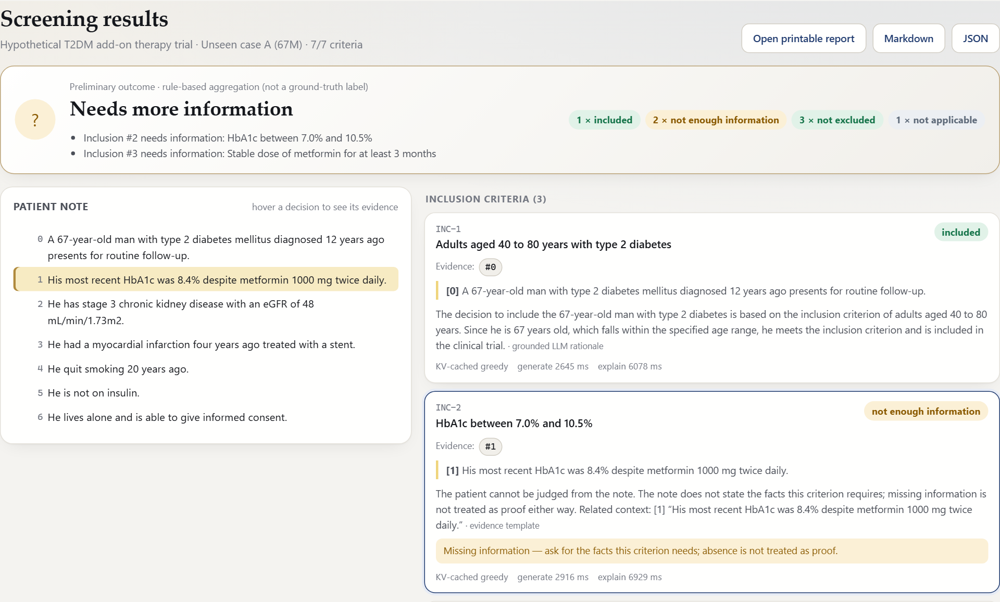
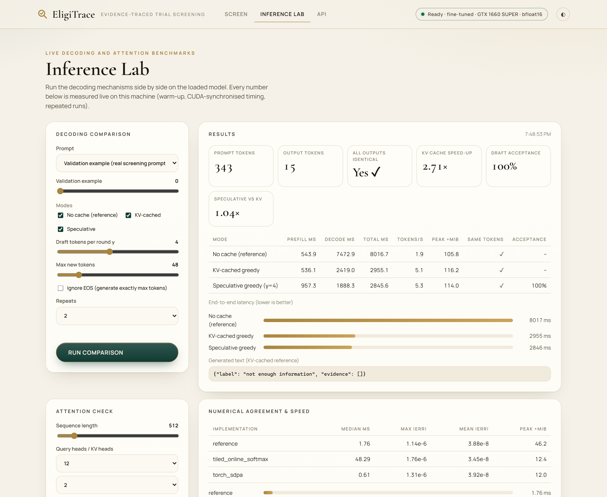

<div align="center">

# 🔎 EligiTrace

### Evidence-traced clinical-trial eligibility screening with a fine-tuned open-weight Transformer

*Every decision points back to the exact patient sentence that supports it.*


</div>

> [!WARNING]
> **EligiTrace is an educational research prototype for screening.** It is **not** a clinical enrollment decision tool and must not be used for medical decisions.

---

## ✨ What is EligiTrace?

Clinical-trial recruitment stalls on one question: *does this patient meet each criterion?* Answering it means
reading a free-text clinical note against dozens of inclusion and exclusion criteria, which is slow, error-prone
and hard to audit.

EligiTrace takes **a patient note**, **a criterion type** (inclusion or exclusion) and **the criterion text**, and returns:

- a **structured eligibility label** that keeps every expert category: `included`, `not included`, `excluded`, `not excluded`, `not enough information` and `not applicable`. Labels are never collapsed into a yes/no answer.
- the **IDs of the patient sentences** that support the decision, together with the exact evidence text;
- a **short explanation** that uses only the cited sentences;
- for a whole trial, a **preliminary patient–trial outcome** built with an explicit rule. This outcome is never presented as ground truth.

The engine is a small, open-weight decoder Transformer (**Qwen2.5-1.5B-Instruct**) adapted with **LoRA**. It runs on
a consumer 6 GB GPU. Its inference stack is hand-built and validated:

| Mechanism | What EligiTrace implements |
|-----------|----------------------------|
| 🧠 **KV-cached decoding** | A decoding loop written by hand. It manages the key/value cache explicitly (prefill, then step-wise reuse), including positions and masks. It is checked token-for-token against a decoder that runs without a cache. |
| ⚡ **Tiled attention with online softmax** | Blocked attention in the FlashAttention style. It keeps a running maximum and normaliser per row and is validated against a reference scaled dot-product attention across many shapes and causal masks. |
| 🚀 **Speculative decoding** | A greedy draft-and-verify loop. A Qwen2.5-0.5B model drafts tokens and the target model checks them. Rejected drafts are corrected and both caches stay in sync. Output tokens must be identical to plain greedy decoding. |

All of it is exposed in a **browser app** that has two parts: a screening workflow with exportable reports, and a live **Inference Lab** that benchmarks the decoding modes side by side.





📄 **Report:** [`report/EligiTrace_Report.pdf`](report/EligiTrace_Report.pdf) (IEEE format; LaTeX source in [`report/`](report/))

---

## 🧭 Table of contents

- [Features](#-features)
- [Architecture](#-architecture)
- [Dataset & evaluation protocol](#-dataset--evaluation-protocol)
- [Quick start](#-quick-start)
- [Usage](#-usage)
- [Results](#-results)
- [Project structure](#-project-structure)
- [Reproducibility](#-reproducibility)
- [Tech stack](#-tech-stack)
- [Limitations](#-limitations)
- [Acknowledgements](#-acknowledgements)
- [Author](#-author)

---

## 🌟 Features

- **Criterion-level eligibility** for both inclusion and exclusion criteria. The label set is validated per criterion type.
- **Evidence localisation**: the model cites the original sentence IDs, and the UI highlights those sentences in the note.
- **Missing information made explicit.** When the note lacks the facts, the model answers `not enough information`. The absence of evidence is never treated as proof.
- **Rule-based overall outcome** (*Likely eligible*, *Likely ineligible* or *Needs more information*), shown with a transparent rule trace.
- **Unseen cases supported.** Paste any clinical note: it is automatically segmented into numbered sentences. Enter criteria by hand or fetch them by NCT ID from ClinicalTrials.gov.
- **Downloadable screening reports** in HTML (print to PDF), Markdown and JSON. Each report records provenance: model, adapter hash, decoding settings, timestamp and commit.
- **Inference Lab**: live comparison of decoding without a cache, KV-cached greedy decoding and speculative decoding. It reports timings, tokens/s, peak memory, token equality and draft acceptance, plus a live attention-correctness check.
- **Robust input handling**: validated inputs, clear error messages, and recovery that does not lose your work.

---

## 🏗 Architecture

```
 ┌──────────────────────── offline research pipeline ────────────────────────┐
 │                                                                           │
 │  🤗 TrialGPT-Criterion-Annotations                                         │
 │        │  drop all model-generated columns                                │
 │        ▼                                                                  │
 │  dataprep ──► patient-grouped split 37/8/8 (seed 42) ──► split manifest    │
 │        │                                                                  │
 │        ▼                                                                  │
 │  formatting (prompt + JSON target) ──► finetune (LoRA SFT, train split)    │
 │                                              │ adapter                    │
 │                                              ▼                            │
 │  evaluation (val during development · test once, frozen) ──► results/     │
 └───────────────────────────────────────────────────────────────────────────┘
                                   │
 ┌──────────────────────────── inference core ───────────────────────────────┐
 │  modeling (Qwen2.5-1.5B + LoRA)  ·  kvcache  ·  attention  ·  speculative  │
 └───────────────────────────────────────────────────────────────────────────┘
                                   │
 ┌────────────────────────────── application ────────────────────────────────┐
 │  web/ (Screen · Results · Export · Inference Lab)                          │
 │        ▲  JSON over HTTP                                                  │
 │  server/eligitrace_api (FastAPI: routers → services → repositories)        │
 │        ▼                                                                  │
 │  SQLite via SQLAlchemy ORM (screenings, criterion results, benchmark runs) │
 └───────────────────────────────────────────────────────────────────────────┘
```

**Model contract** (shared by training, evaluation and the app):

```jsonc
// input  : numbered patient sentences + criterion type + criterion text + allowed labels
// output :
{"label": "not enough information", "evidence": [0, 1, 2]}
```

---

## 📊 Dataset & evaluation protocol

- **Dataset**: [`ncbi/TrialGPT-Criterion-Annotations`](https://huggingface.co/datasets/ncbi/TrialGPT-Criterion-Annotations). It has 1,015 expert-annotated criterion judgements covering 53 patients and 103 trials.
- **No leakage**: GPT-4 predictions, explanations and sentence choices are removed before formatting. A test scans every prompt to prove they are absent.
- **Fixed patient-grouped split**: the unique patient IDs are sorted, then shuffled with `numpy.random.default_rng(42)`. The first 37 patients form the training split, the next 8 validation and the last 8 test. The published manifest is [`data/splits/split_manifest.json`](data/splits/split_manifest.json).
- **Untouched test set**: all tuning uses the validation split. A code-level guard allows exactly one frozen evaluation on the test split.
- **Metrics**:
  - Classification: accuracy, macro-F1, per-class precision/recall/F1 and confusion matrices, reported overall and separately for inclusion and exclusion criteria.
  - Evidence: micro and macro precision, recall and F1, with explicit rules for empty gold or predicted sets.

---

## 🚀 Quick start

> **Requirements:** Windows, Linux or macOS · Python 3.12 · [uv](https://docs.astral.sh/uv/) · [Task](https://taskfile.dev) · an NVIDIA GPU with at least 6 GB is recommended (a CPU fallback is supported but slow).

```bash
git clone https://github.com/ruhank-dev/eligitrace.git
cd eligitrace

task setup              # create the environment from uv.lock
task download-weights   # fetch the base/draft models and the EligiTrace LoRA adapter
task app                # start the app at http://127.0.0.1:8000
```

Then open **http://127.0.0.1:8000** in your browser. You do not need a notebook or an IDE.

---

## 🖥 Usage

| Command | What it does |
|---------|-------------|
| `task app` | Start the browser application |
| `task data` | Download the dataset, build the split and manifest, and compute token statistics |
| `task train` | Fine-tune the target model with LoRA (config in `finetune/configs/`) |
| `task eval-val` | Evaluate on the validation split |
| `task eval-final` | One-time frozen evaluation on the held-out test split |
| `task bench-kv` | Benchmark decoding with and without the KV cache, plus equality tests |
| `task bench-attn` | Validate and benchmark tiled online-softmax attention |
| `task bench-spec` | Benchmark speculative decoding, plus equality tests |
| `task test` | Run the test suite |

The API is self-documenting. While the app is running, open **http://127.0.0.1:8000/docs** to explore and try every endpoint.

---

## 📈 Results

Every number here comes from files in [`results/`](results/). The test split was evaluated **once**, after the model, prompt and decoding settings were frozen ([`FROZEN.json`](results/final_test/FROZEN.json)). Hardware: a single **GTX 1660 SUPER (6 GB)**, bf16, batch size 1.

### Before vs after fine-tuning (held-out test patients, n = 206 criteria)

| Model | Accuracy | Macro-F1 (present labels) | Inclusion F1 | Exclusion F1 | Evidence micro-F1 | Evidence macro-F1 | Unparseable |
|---|---|---|---|---|---|---|---|
| Qwen2.5-1.5B-Instruct, zero-shot | 0.160 | 0.155 | 0.207 | 0.056 | 0.169 | 0.354 | 0 % |
| **+ EligiTrace LoRA** | **0.733** | **0.528** | **0.425** | **0.398** | **0.561** | **0.819** | **0 %** |

Patient-level bootstrap 95 % CIs (fine-tuned): accuracy [0.583, 0.843], macro-F1 [0.436, 0.608]. On the validation split the fine-tuned model reaches 0.738 accuracy and 0.543 macro-F1.
The model is precise on `included` (precision 1.00) and `not excluded` (F1 0.82). The rare `not included` and `not applicable` labels remain weak; see the [error analysis](results/final_test/finetuned/error_analysis.md).

### Inference mechanisms

| Mechanism | Headline result |
|---|---|
| KV-cached decoding | **3.6×** faster decoding than recomputation at 128 context tokens, **10×** at 512 and **18–20×** at 1,024. The cache costs only 28 KiB per token thanks to grouped-query attention. |
| Tiled online-softmax attention | Matches a genuine float64 reference to **2.5e-6** in fp32 over 432 cases (PyTorch SDPA: 2.8e-6). At 4,096 tokens it needs **41 MiB vs 1.9 GB** of extra memory compared with unfused attention, but it is slower because it is a Python loop over tiles, not a fused kernel. |
| Speculative decoding (0.5B draft) | **91 %** draft acceptance at γ = 1, and 0.31 target forwards per token at γ = 8. Even so, it runs at **0.39–0.69×** the speed of KV-cached greedy decoding: on this launch-bound GPU, a 24-layer draft step costs nearly as much as a 28-layer target step. Fine-tuning the draft lifts acceptance at γ = 4 from 0.59 to 0.85 and the speed to 0.75× (best 0.79× at γ = 6), but it is still slower. These negative results are reported as measured. In the live Inference Lab, where the draft accepts every token of a short answer, speculative decoding was **1.43 ± 0.22×** faster than KV-cached decoding over five repeated runs (range 1.18–1.73×; timings vary on a shared GPU). |

In bf16, 4 of the 9 KV-cache benchmark cases (and some speculative generations) differ from the reference decoder. The differences come from two logit ties within one bf16 rounding step (a margin of 0.125). Re-running all four cases in fp32 on the CPU gives identical tokens, which is how we check that the decoders themselves are exact. The GPU test measures each tie and accepts a bf16 divergence only when the logit gap is explained by the measured path noise (`speculative/ties.py`); a float32 test with no tolerance is `task test-slow`. Full analysis: [`report/`](report/).

### Additional validation experiments (validation split only; the test set was used once)

Same pipeline, one change per run, 206 validation criteria. Summary files: [`results/experiments/`](results/experiments/).

| Run | Accuracy | Macro-F1 | Evidence F1 | Reading |
|---|---|---|---|---|
| Seeds 42 / 43 / 44 | 0.738 / 0.757 / 0.752 | 0.543 / 0.608 / 0.450 | 0.532 / 0.579 / 0.538 | accuracy is stable (0.749 ± 0.010); macro-F1 swings by 0.16 because the rare classes have 2–3 validation examples |
| Oversample rare labels ×3 | 0.767 | 0.621 | 0.504 | promising but within seed noise |
| QLoRA (4-bit base) | 0.709 | 0.415 | 0.532 | lower accuracy than bf16 LoRA; saves 0.9 GB |
| LoRA rank 8 | 0.733 | 0.470 | 0.513 | half the parameters, within noise of rank 16 |
| Fine-tuned 0.5B draft | 0.748 | 0.445 | 0.448 | used as the speculative draft (see above) |

Rank 32 and a lower learning rate were configured but not run (time). The frozen model remains the seed-42 rank-16 bf16 LoRA run.

| Area | Files |
|------|-------|
| Before/after table and CIs | [`results/final_test/`](results/final_test/) |
| Training curves and logs | [`results/training/`](results/training/) |
| KV-cache benchmark | [`results/kvcache/`](results/kvcache/) |
| Attention validation and benchmark | [`results/attention/`](results/attention/) |
| Speculative decoding benchmark | [`results/speculative/`](results/speculative/) |
| Extra experiments, live Lab runs, tie checks | [`results/experiments/`](results/experiments/), [`results/lab/`](results/lab/), [`results/speculative/tie_check.json`](results/speculative/tie_check.json) |

---

## 🧪 Tests and demo helpers

| Command | What it runs |
|---|---|
| `task test` | CPU suite (tiny float64 models, API, metrics, split leakage); no GPU needed |
| `task test-gpu` | real Qwen pair in bf16 on the GPU (ties measured, see above) |
| `task test-slow` | real Qwen pair in float32 on the CPU with no tolerance (tens of minutes) |
| `task lint` | ruff |
| `task demo-check` | read-only readiness check before a demo; walkthrough in [`demo/DEMO_WALKTHROUGH.md`](demo/DEMO_WALKTHROUGH.md) |
| `task exp-run` / `task exp-summary` | rerun the validation-only experiments and collect their table |

---

## 🗂 Project structure

```
eligitrace/
├── settings/          # Pydantic settings (the only place environment variables are read)
├── dataprep/          # Dataset loading, leakage-safe cleaning, patient split, manifest
├── modeling/          # Model loading, prompt contract, output schema, parser, explanations
├── finetune/          # LoRA supervised fine-tuning + configs
├── evaluation/        # Prediction, metrics, error analysis, test-set guard, plots
├── kvcache/           # Cache-aware decoder, decoder without cache, benchmarks
├── attention/         # Reference SDPA, tiled online-softmax attention, validation
├── speculative/       # Greedy speculative decoding, benchmarks, tie checks, live Lab evidence
├── server/            # FastAPI app (routers · schemas · repositories · services · orm)
├── web/               # Browser UI (Screen · Inference Lab)
├── tests/             # pytest suite
├── demo/              # Demo preflight check, sample inputs, walkthrough
├── data/splits/       # Published split manifest
├── results/           # Metrics, logs, benchmark CSVs, figures
└── report/            # IEEE LaTeX paper
```

---

## 🔁 Reproducibility

- Exact dependency versions are pinned in `uv.lock`; `task setup` reproduces the environment.
- The dataset revision is pinned, and the split is deterministic (seed 42). Tests check it.
- All hyperparameters live in versioned YAML configs; training logs and curves are committed.
- The LoRA adapter is hosted on the Hugging Face Hub at [`arceus1rk/eligitrace-qwen2.5-1.5b-lora`](https://huggingface.co/arceus1rk/eligitrace-qwen2.5-1.5b-lora) (adapter SHA-256 `eb1843b2…`), and `task download-weights` fetches it.
- Benchmarks use warm-up runs, synchronised CUDA timing and repeated measurements; environment details are logged with every result.

---

## 🧰 Tech stack

**Modelling:** PyTorch · 🤗 Transformers · PEFT (LoRA) · Datasets · scikit-learn
**Application:** FastAPI · Pydantic v2 · SQLAlchemy · a vanilla HTML/CSS/JS frontend (no build step)
**Tooling:** uv · Task · pytest · ruff · LaTeX (IEEEtran)

---

## ⚠️ Limitations

- The supervised data is small (53 patients) and the test split has only 8 patients, so metrics carry wide uncertainty.
- Some expert labels are rare (for example `excluded`), which limits per-class reliability.
- The overall patient–trial outcome is a rule-based aggregation; it is not an expert-labelled result.
- This is a research prototype that has not been clinically validated.

---

## 🙏 Acknowledgements

- The dataset and the reference study come from Jin et al., *TrialGPT* (NCBI/NLM). EligiTrace studies that project as a reference only and does not reuse its code or results.
- Model weights: the Qwen team (Apache-2.0).

Claude was used to assist with research and certain aspects of project implementation.

---

## 👤 Author

**Muhammad Ruhan Kamran** · 23i-0062 · CS-A

<div align="center"><sub>Built for research and learning — not for clinical decision-making.</sub></div>
